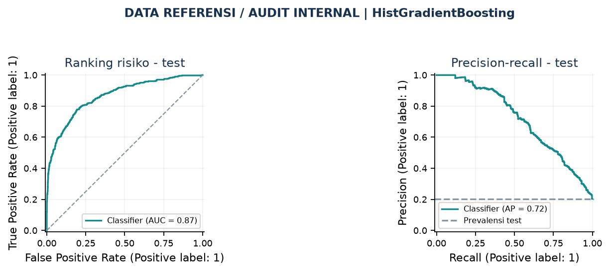
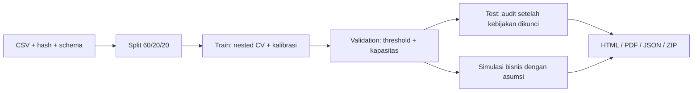

# Banking Churn Reduction - V7

[](https://github.com/alandehars/banking-churn-reduction/actions/workflows/ci.yml)
[](https://colab.research.google.com/github/alandehars/banking-churn-reduction/blob/main/notebooks/banking_churn_v7.ipynb)

Studi kasus churn perbankan dengan penjelasan Indonesia, tujuh form simulasi, dan laporan HTML/PDF.
V7 memakai **kode yang sama untuk notebook, CLI, dan pengujian**, dengan dependensi terkunci.
[Notebook V6](notebooks/banking_churn_v6.ipynb) tetap disimpan tanpa perubahan.

**Lihat hasil:** [ringkasan PDF](docs/reports/executive_summary.pdf) ·
[HTML mandiri yang dapat diunduh](docs/reports/executive_summary.html) ·
[angka dan asumsi agregat](docs/reports/public_summary.json) ·
[Colab V7 di Drive](https://colab.research.google.com/drive/1OlYlT8VhD7e323tNt0A9vm-comOiEIVU).
Tautan Drive mengikuti izin pemilik. HTML pada GitHub ditampilkan sebagai sumber; unduh untuk membukanya.



## Apa yang berubah

| Bagian | V7 |
| --- | --- |
| Reproduksi | Python 3.12/3.13; `uv.lock`, ekspor requirements dengan hash, 16 dependensi akar dipatok |
| Kode bersama | Preprocessing, nested CV, kalibrasi, threshold, inferensi, keputusan, dan laporan dalam `src/banking_churn/` |
| Notebook | 14 sel kode, 16 sel penjelasan, tujuh form; paket yang sama disematkan dengan hash agar mandiri di Colab |
| Pengujian | 49 pengujian termasuk satu run sintetis lengkap; notebook dijalankan pada kernel sungguhan |
| CI | Matriks Windows/Linux × Python 3.12/3.13 memasang lock, menguji kode, dan menjalankan semua sel serta form dengan data sintetis |
| Hasil | Grafik ROC/PR, ringkasan HTML/PDF, asumsi bisnis yang terlihat, JSON agregat, ZIP per run |

Perubahan arsitektur ini meningkatkan keterujian dan keterlacakan. Ia tidak otomatis menaikkan akurasi.
Run referensi lokal memberi **ROC-AUC 0,8653** dan **AP 0,7165**, sama dengan baseline V6 lokal.
Default F1 memprioritaskan **449 dari 2.000** catatan test: TP 267, FP 182, FN 140.
Ini audit internal pada test yang sudah dilihat selama pengembangan; validasi baru masih diperlukan.



## Coba di Colab

1. Klik **Open in Colab**, simpan salinan ke Drive, lalu **Runtime > Run all**.
2. Pilih `reference_source` untuk CSV yang diberikan pengguna, atau `synthetic_smoke` untuk demo cepat.
3. Bila unduhan sumber gagal, unggah CSV dari [tautan data pengguna](data/README.md) ke Files dan isi `Path_CSV`.
4. Colab memasang lock analisis dari requirements-colab-lock.txt dan mempertahankan kernel/UI bawaan. Jika instalasi mengganti paket yang sudah dimuat, pilih **Runtime > Restart session**, lalu **Run all** kembali.
5. Setelah training, ubah parameter form dan jalankan sel tersebut. Unduh hasil melalui panel Files.

Tujuh form meliputi profil what-if, threshold, kapasitas, retensi/biaya, advisor anggaran,
ketidakpastian parameter, dan kualitas/scoring batch. Form memakai validation atau profil fiktif;
eksplorasi tidak mengganti threshold default audit. Advisor, ketidakpastian, dan batch memperbarui
HTML/PDF dan ZIP. Empat form dasar menyimpan snapshot eksplorasi tersendiri.

## Jalankan lokal dengan paket terkunci

Gunakan Python **3.12 atau 3.13** dan [uv 0.13.5](https://docs.astral.sh/uv/getting-started/installation/).
Dari root repo:

```sh
uv sync --locked --all-groups
uv run --locked banking-churn smoke --output-base artifacts/synthetic
uv run --locked python scripts/run_notebook_v7.py --smoke
```

Mode smoke membangkitkan 1.000 catatan fiktif, menjalankan seluruh tahap, dan menandai semua laporan
sebagai **DATA SINTETIS**. Metriknya membuktikan fungsi alur, bukan performa bank nyata.

Untuk CSV referensi yang disimpan di luar repo:

```sh
uv run --locked banking-churn train --data /path/to/Churn_Modelling.csv
uv run --locked python scripts/run_notebook_v7.py --data-file /path/to/Churn_Modelling.csv
```

Pada Windows, ganti path sesuai lokasi file. Hash sumber diperiksa secara default. CSV lain yang
sudah ditinjau dapat digunakan pada CLI dengan `--allow-reviewed-source`; konteksnya dicatat
sebagai `external_reviewed`, bukan sumber referensi. CLI tidak membuktikan provenance sumber baru.

Alternatif pip: buat virtual environment Python 3.12/3.13, jalankan
`python -m pip install --require-hashes -r requirements-lock.txt`, lalu
`python -m pip install --no-deps --no-build-isolation -e .`.
Ekspor lock mencakup alat pengembangan dan marker OS. V6 memiliki langkah setup lama di dalam notebook;
untuk lingkungan terkunci yang aktif gunakan V7.

## Inferensi dan keluaran

```sh
uv run --locked banking-churn score --bundle /trusted/run/bank_churn_bundle.joblib --input examples/synthetic_customers.csv --output outputs/scored.csv
uv run --locked banking-churn report --run-dir /path/to/completed/run
```

Hanya muat bundle dari sumber tepercaya dengan versi paket yang cocok; format joblib dapat menjalankan kode.
`predict_customers.py` dalam setiap run adalah helper mandiri dari modul inferensi yang sama.
Schema, kategori asing, nilai di luar rentang, dan kolom ganda diperiksa sebelum scoring.

Setiap run menghasilkan ID unik. `latest_run.json` hanya diperbarui setelah laporan dan ZIP lolos
pemeriksaan. ZIP berisi model, metadata, tabel audit, helper, laporan, serta hasil batch lokal.
**Tinjau isinya sebelum membagikan ZIP.** Repo public hanya menyertakan kode, contoh sintetis,
dan ringkasan agregat yang diperiksa; CSV mentah, bundle, serta skor per pelanggan diabaikan Git.

## Pengujian dan kontribusi

```sh
uv run --locked python scripts/check_notebook.py
uv run --locked python scripts/check_notebook_v7.py
uv run --locked python -m unittest discover -s tests -v
uv run --locked python scripts/run_notebook_v7.py --smoke
```

Setelah mengubah modul, jalankan `uv run --locked python scripts/sync_notebook_v7.py` untuk
menyematkan versi yang sama ke notebook. Pemeriksa menolak source/hash/lock yang berbeda atau
output pribadi yang tertinggal. CI memakai data sintetis tanpa CSV sumber atau kredensial Drive.
Windows dan Linux memakai dependensi universal dari `uv.lock` dengan marker sesuai platform.
Notebook mencatat versi yang benar-benar digunakan pada metadata setiap run.

| Lokasi | Kegunaan |
| --- | --- |
| `src/banking_churn/pipeline.py` | Training dan audit bersama |
| `src/banking_churn/inference.py` | Schema dan scoring bersama |
| `src/banking_churn/reporting.py` | Ekspor agregat HTML/PDF |
| `tests/test_pipeline.py` | Uji lengkap sintetis, reload, scoring, dan integritas laporan |
| `docs/reports/` | Snapshot referensi agregat; tidak berubah mengikuti form lokal |
| [VALIDATION](docs/VALIDATION.md) | Bukti eksekusi, protokol, dan batas pemeriksaan |
| [MODEL_CARD](docs/MODEL_CARD.md) | Cakupan penggunaan dan keterbatasan |

## Interpretasi dan langkah berikutnya

Sumber adalah CSV pengguna 10.000 catatan, tanpa timestamp maupun treatment/control.
Penerbit asal, horizon label, mata uang, dan lisensi redistribusi data belum terverifikasi.
Skor dan importance tidak mengukur penyebab churn. Simulasi memakai biaya C, manfaat B,
keberhasilan u, dan biaya tetap F yang merupakan asumsi; hasilnya bukan ROI yang telah diamati.

Prioritas berikutnya: konfirmasi definisi churn dan biaya, kumpulkan data periode/populasi baru,
validasi kebijakan yang dibekukan, lalu uji penawaran terhadap kelompok kontrol. Model uplift
baru layak dipertimbangkan setelah data intervensi yang memadai tersedia.
